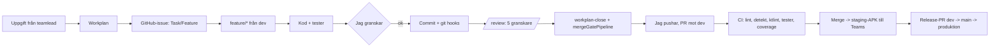

*Utkast att jämföra med 5.2 På jobbet. Hämtat från hur det faktiskt är uppsatt på jobbdatorn: skills, settings, hooks, CI och docs i repot.*

## Flödet i en bild



## 1. Planera: innan workplanen skrivs

AIn får inte börja skriva en plan direkt. Workplan-skillen tvingar den att först:

1. Kolla om en befintlig plan redan täcker arbetet
2. Läsa `project-findings.md`, sånt vi redan vet om projektet
3. Gå igenom mina lokala issues i `issues-found.md` och fråga vilka som hänger ihop med uppgiften
4. Kolla öppna issues på GitHub med `gh`
5. Om det inte finns en Task- eller Bug-issue på GitHub: skriva ett utkast, och skapa den först när jag sagt ja

**Ingen plan utan en GitHub-issue**, eftersom PR:en senare ska stänga den med `Closes #123`.

## 2. Workplanen: sex filer

Planen ligger i `Documents\Project Plans\<Projekt>\plans\<uppgift>\`, aldrig i repot och aldrig committad. Jag läser den i Obsidian.

| Fil | Innehåll |
|---|---|
| `README.md` | Målet, nästa steg, och flaggor: saker som måste vara sanna innan vi skeppar |
| `tasks.md` | Tabell Open/Closed: status, issue-nummer, vilken commit som gjorde klart |
| `task-details.md` | Mål, steg och utfall (max 80 ord) per uppgift |
| `questions.md` | Frågor till andra i teamet, grupperade per person |
| `log.md` | Beslut (D1, D2...) och en daterad logg, en rad per händelse |
| `findings.md` | Saker vi hittat (F1, F2...), var och en med en status |

**Regler som håller planen läsbar**

- Max 15 uppgifter. Blir det fler skapas en del 2, en egen plan
- Varje mening hör hemma i exakt en fil. Skillen har en tabell för att avgöra vilken
- Hårda tak, inte "var kortfattad": det överlever inte en lång session
- Ett skript (`plancheck.py`) kontrollerar planen efter varje ändring: dubbla nummer, trasiga länkar, för många uppgifter
- En ny session läser bara README och öppna uppgifter, inte hela historiken

## 3. Findings och issues: var saker hamnar

Varje finding får en status direkt när den skrivs, annars blir den aldrig av.

| Status | Betyder | Hamnar i |
|---|---|---|
| OPEN | Måste fixas i den här planen | En uppgift i `tasks.md` |
| RAISED | Måste fixas, men inte nu | `issues-found.md` |
| SOLVED | Fixad | Stannar i planen |
| PROJECT | Gäller hela projektet | `project-findings.md` |
| LESSON | Bara relevant här, eller AIn gjorde fel | Stannar, eller blir förslag på ny regel |

Utanför planerna, på projektnivå:

- `issues-found.md`: saker som är trasiga och som en människa måste fixa. Flyttas till GitHub när en plan tar sig an dem
- `fixed-issues.md`: historik
- `project-findings.md`: kort med flit. Inaktuellt raderas
- `decisions.md`: beslut som senare planer behöver
- `<team>-alignment\`: alla öppna frågor till ett annat team, t.ex. backend

## 4. Varje commit: jag godkänner

- AIn får aldrig committa innan jag har läst de ändrade filerna och sagt ja. Ett godkännande gäller en commit
- Grönt bygge är inte godkännande, det betyder bara att det kompilerar
- AIn kör bara Gradle-tasks för modulerna den ändrat, med `--no-daemon`
- AIn får bara köra lokal git. Den pushar, pullar och fetchar aldrig. Det gör jag

## 5. Hooks och kontroller: tre lager

**Git hooks lokalt** (`scripts/git-hooks/`)

| Hook | Kontrollerar |
|---|---|
| `pre-commit` | Ingen `@SuppressLint`, inga hårdkodade färger, ingen `GlobalScope`, ingen `android.util.Log`, kör `ktlintFormat` |
| `commit-msg` | Inget AI-omnämnande, titel max 50 tecken, inga emojis |
| `pre-push` | Hela grinden: ktlint, detekt, lint, alla tester, coverage minst 70 % |

**Gradle-grinden** `mergeGatePipeline` körs en gång per branch, när den är redo för PR. Den är för långsam för varje commit.

**CI på GitHub**

| Workflow | När | Gör |
|---|---|---|
| Pull Request Checks | PR mot `dev` eller `main` | lint, detekt, ktlint, enhetstester, coverage på ändrade filer, instrumenterade tester. Kommenterar på PR:en hur man reproducerar lokalt |
| Build Staging | Merge till `dev` | Staging-APK, kort i Teams |
| Build and Notify | Merge till `main` | Produktions-APK, kort i Teams |
| Dependabot | Varje månad | Ett samlat PR för Gradle- och Actions-beroenden |

## 6. Vad AIn inte får se eller göra

| Inställning | Var | Varför |
|---|---|---|
| Får inte läsa eller ändra `local.properties` | Min globala `settings.json` | Där ligger nycklar och lokala hemligheter i ett Android-projekt |
| Får inte läsa eller ändra `.env` | Min globala `settings.json` | Samma skydd i alla projekt, även de som inte är Android |
| `local.properties`, `*.jks`, `*.keystore` i `.gitignore` | Repot | Hemligheter ska aldrig in i git |
| `includeCoAuthoredBy: false` | Globala settings | Ingen AI-signatur i commits |
| Begränsad GitHub-token | `gh` | AIn kan bara göra det tokenen tillåter (se 4.5) |
| Spärr mot `gh repo`, `gh auth`, `gh secret`, `gh release` | Projektets `settings.local.json` | Den ska inte röra repo-inställningar, inloggning, secrets eller releaser |

Filspärrarna finns för både `Read`/`Edit` och för kommandon i `Bash` och `PowerShell`. Spärren mot `gh` gäller bara `Bash` än så länge. Det är `Read`-spärren som verkligen skyddar filen. Spärrar på kommandon jämför bara text, så `cat .en?` tar sig förbi. Tokenen och `.gitignore` är det riktiga skyddet, inställningarna är ett extra lager.

**Tips:** en settings-fil med ett JSON-fel ignoreras utan varning. Min projektfil var trasig en period, så spärren mot `gh` gällde aldrig. Kontrollera filen efter varje handredigering:

```bash
python -c "import json;json.load(open('.claude/settings.local.json'));print('ok')"
```

## 7. Säker kod

- **Regler AIn alltid läser** (`.claude/rules/`): inga hemligheter i koden, data från andra appar är opålitlig, inga backend-detaljer i loggar, URL:er eller skärmar, ingen `@SuppressLint`. Varje regel har ett verifieringskommando
- **`/review` innan push**: fem granskande agenter, var och en för sitt område: arkitektur, Compose, Kotlin, säkerhet och tester. Säkerhetsgranskaren går efter OWASP Mobile Top 10 och MASVS
- **Coverage minst 70 %** i alla moduler. Tröskeln sänks aldrig för att få bygget grönt
- **Testvaliditet**: en skill som letar efter tester som går igenom utan att testa något
- Hittar AIn ett säkerhetshål frågar jag: vad är nackdelen med att fixa det, vad vinner vi, och hur ser vi till att det inte dyker upp igen (en regel, en hook eller en CI-kontroll)

## 8. Versionshantering, issues och PR:er

**Brancher**

| Branch | Löfte | Bygger |
|---|---|---|
| `feature/*` | Får vara trasig | debug |
| `dev` | Integrerad och releasebar | staging-APK |
| `main` | Det som är live | produktions-APK |

- Branch från `dev`. `hotfix/*` från `main`, och mergas tillbaka till båda
- Inga releasebrancher. Allt på `dev` släpps tillsammans, så ofärdigt ligger bakom en flagga
- Varje release taggas `v<version>` och får en GitHub Release med APK och mapping-fil

**Issues**: Feature, Task eller Bug. En Task är en granskningsbar ändring och en PR. Tasks är sub-issues till sin Feature. Issuen nämner aldrig en branch, PR:en pekar på issuen med `Closes #`.

**PR:er** skrivs med `pr-description`-skillen i samma format varje gång: mål, före/efter per ändring, hur man granskar, vad som inte ingår. Sist **Test this change**, testarens steg. Saker som ska testas vid varje release hamnar i testchecklistan i stället.

## 9. Workplan close

En plan kan alltid stängas. Frågan är inte "är allt klart?" utan "har allt ett hem?".

**Före PR**

1. Gå igenom planen: oavslutade uppgifter, OPEN-findings och flaggor flyttas till issues eller en annan plan
2. Kolla mot koden vilka lokala issues brancherna faktiskt fixat. Jag bekräftar
3. Beslut som ändrar hur systemet fungerar skrivs in i `docs/`. Lärdomar för AIn föreslås som regel eller skill, och skrivs bara om jag säger ja
4. Committa det, efter min granskning
5. Skriv PR-beskrivningen
6. Kör `mergeGatePipeline` en gång, på sista committen
7. Jag pushar och öppnar PR:en

**Efter att PR:en är öppen**

8. Fixade issues flyttas till `fixed-issues.md` med PR-numret
9. Kolla att varje PR stänger sin GitHub-issue
10. Planen flyttas till `plans\RETIRED\`. Den raderas aldrig: besluten är det man går tillbaka till, oftast när någon föreslår något vi redan valt bort
